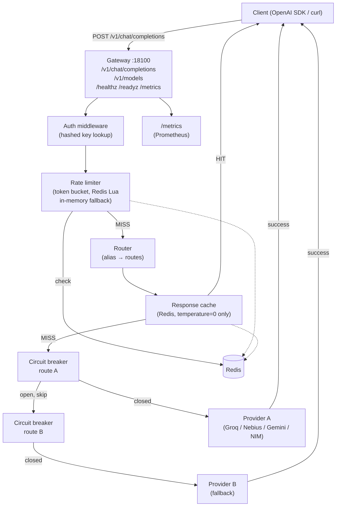

# LLM Gateway

A single OpenAI-compatible endpoint in front of multiple LLM providers with
automatic fallback, rate limiting, response caching, and circuit breaking.
Built in Go because Go's standard library makes the concurrency model explicit
and the whole gateway fits in one binary with no runtime dependencies.

The motivation is real: a job-hunt automation agent broke when one provider hit
its rate limit. This gateway is what should have been there from the start.

## Architecture



## Quickstart

```bash
# 1. Clone and build
git clone https://github.com/yashash-pushkar/llm-gateway
cd llm-gateway
go build ./...

# 2. Copy and fill in provider keys
cp .env.example .env
# edit .env: set GROQ_API_KEY, GEMINI_API_KEY, etc.

# 3. Start fake upstream (no real keys needed for demo)
./bin/fakeupstream -addr :18101 -latency 20 &

# 4. Start the gateway
source .env && ./bin/gateway -config config.example.yaml

# 5. Send a request
curl -s http://localhost:18100/v1/chat/completions \
  -H "Content-Type: application/json" \
  -d '{"model":"demo","messages":[{"role":"user","content":"hello"}]}'
```

Expected output:
```json
{"choices":[{"finish_reason":"stop","index":0,"message":{"content":"fake response #1 to model=fake-model","role":"assistant"}}],"created":1794425987,"id":"chatcmpl-fake-1","model":"fake-model","object":"chat.completion","usage":{"completion_tokens":15,"prompt_tokens":10,"total_tokens":25}}
```

## Results (measured locally, Windows laptop + fake upstream with 20 ms fixed latency)

All numbers from `VERIFY.md`. Setup: Gateway + fakeupstream on localhost, no Redis.

| Metric | Value |
|--------|-------|
| Gateway overhead p50 | ~1 ms over direct call |
| Gateway overhead p95 | ~2 ms |
| Throughput at 20 VUs | ~461 req/s, 0% errors |
| Fallback success rate | 100% (429 → next provider) |
| Cache HIT latency | < 1 ms (requires Redis) |
| Go benchmark: proxy handler | 197 µs/op, 59 kB/op |
| Go benchmark: circuit breaker | 232 ns/op, 0 allocs |
| Unit + integration tests | 10 packages, 0 failures |

Hardware: Intel i7-14700HX, 16 GB RAM. Fake upstream, no real LLM calls for load tests.

## Design decisions

- **Standard `net/http.ServeMux`** (Go 1.22+ method patterns) — no chi/gorilla dep.
- **Custom circuit breaker** — 90 lines, easy to explain; avoids sony/gobreaker.
- **Redis Lua scripts** for atomic token-bucket rate limiting across replicas.
- **Fail-open** rate limiting when Redis is down (availability over strict enforcement).
- **Streams not cached** — buffering SSE adds unbounded latency; documented in DESIGN.md.
- **Partial stream safety** — once bytes sent to client, no retry on a different provider.

See [docs/DESIGN.md](docs/DESIGN.md) for trade-off analysis and failure modes.

## Limitations / next steps

- No weighted/random routing (strict priority order only).
- Cache requires Redis; without Redis, all requests hit upstream (safe but no speedup).
- Streaming responses are not cached.
- Race-detector tests run in CI on ubuntu-latest (Windows host lacks gcc).
- No TLS on the gateway port (terminate at load balancer).
- OpenAI function-calling / tool-use fields pass through raw but are not validated.

## MIT License

Copyright (c) 2026 Yashash Mathur
